<div align="center">

# `$ termfolio`

**Generate an animated, terminal-style GitHub profile README in under a minute.**



[Live demo](https://hereisvaibhav.github.io/termfolio/) &nbsp;·&nbsp; [Report a bug](../../issues) &nbsp;·&nbsp; [Request a feature](../../issues)

</div>

---

## What is this?

termfolio turns your details into a `neofetch`-style terminal card for your GitHub profile. You fill in a form, watch the live preview, then copy or download two files: an animated `terminal.svg` and a ready-made `README.md`. It runs fully in your browser, needs no build step, and sends nothing anywhere.

## Features

- Live preview that updates as you type
- Animated pixel art: invader, rocket, ghost, robot, beating heart, coffee cup, UFO
- **Custom art:** paste your own pixel grid (up to 4 frames, 24×24) and it animates
- Up to 8 editable info lines (name, role, skills, location, anything)
- `~/.plan` checklist with `[x]`, `[~]` and `[ ]` items
- Accent color picker
- Optional link buttons (LinkedIn, website, email, X)
- Blinking cursor, window buttons and a color bar, like a real terminal
- **Change each character:** swap the built-in artwork or paste your own letter-coded pixel art with custom colors and frames
- **Extra animated cards** (each optional and editable): skills bars, circular performance rings, stats, four pixel-art characters, an ID card and a "Let's build together" grid
- One HTML file, no dependencies, works offline

## How to use it

1. Open the live demo (or `index.html` locally).
2. Type your GitHub username, fill in your info lines, pick your pixel art and accent color.
3. Open **Extra cards** to edit or switch off the skills, rings, stats, characters, ID card and build grid.
4. For each file in the **SVG file** list, click **Download SVG** (or **Copy SVG**). Then click **Copy README.md**.
5. Create a public repo named exactly like your GitHub username.
6. Upload all the SVG files to that repo and use the copied README as your `README.md`.
7. Commit, then refresh your profile page.

> Upload the SVG as a file. Pasting its text into GitHub's web editor can corrupt it.

## Custom pixel art

Choose **Custom (paste your own)** and draw with text:

```
..#####..
.#.....#.
#..#.#..#
#.......#
#.#...#.#
#..###..#
.#.....#.
..#####..
```

- `#` (also `X`, `1`, `*`) is a filled square, `.` is empty.
- Leave a blank line and paste another grid to add an animation frame (up to 4).
- Shorter rows are padded and the art is resized to fit the card.

## Run locally

No install needed:

```bash
git clone https://github.com/hereisVaibhav/termfolio.git
cd termfolio
open index.html   # or just double-click the file
```

## Deploy your own copy

1. Fork this repo.
2. Go to **Settings → Pages**, choose the `main` branch and the root folder.
3. Your generator is live at `https://<your-username>.github.io/termfolio/`.

## Project structure

```
termfolio/
├─ index.html        the whole app (HTML, CSS and JS in one file)
├─ assets/
│  └─ preview.svg    example output used in this README
├─ README.md
├─ CONTRIBUTING.md
└─ LICENSE
```

## Roadmap

- [ ] Click-to-draw pixel editor
- [ ] More art styles and theme presets (Dracula, light)
- [ ] More characters and card themes
- [ ] Share a link with your settings pre-filled

## Contributing

Ideas and pull requests are welcome. See [CONTRIBUTING.md](CONTRIBUTING.md).

## License

[MIT](LICENSE)

If termfolio helped you, a star on the repo is appreciated.
